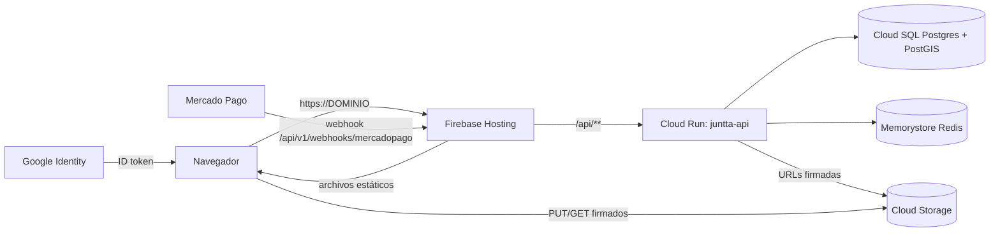

# Implementación en Firebase / Google Cloud

Receta para publicar Juntta Feria en producción con **Firebase** y los servicios de **Google Cloud** que Firebase usa por debajo.

> Estado: receta inicial. Cada paso marcado con **Verificar** tiene que probarse en el proyecto real antes de abrir el sitio a usuarios.

## 1. Qué servicio va para qué

| Pieza | Servicio | Por qué |
|---|---|---|
| Web (Angular) | **Firebase Hosting** | CDN, HTTPS y dominio propio; sirve el build estático y reenvía `/api/**` a la API. |
| API (NestJS) | **Cloud Run** (detrás de Hosting) | Corre el contenedor tal cual. Hosting la expone bajo el mismo dominio que la web. |
| Base de datos | **Cloud SQL para PostgreSQL** (con PostGIS) | La API depende de Postgres: transacciones, constraints, RLS y PostGIS. |
| Archivos (documentos del expositor) | **Cloud Storage para Firebase** | Es un bucket de Google Cloud Storage. La API lo usa por su interfaz compatible con S3. |
| Contadores (límite de intentos y de pedidos) | **Memorystore for Redis** (o Upstash) | La API usa Redis para los límites de pedidos. |
| Secretos | **Secret Manager** | Tokens de Mercado Pago, claves de sesión y contraseñas de la base. |
| Banderas de configuración | **Remote Config** (opcional) | Ver §11. |

### Por qué Realtime Database y Firestore **no** reemplazan a Postgres

La API no es un CRUD de documentos. Depende de cosas que una base NoSQL no da:

- **Concurrencia de reservas (INV-01):** dos feriantes no pueden retener el mismo stand. Hoy lo garantizan un constraint único y transacciones de Postgres.
- **Aislamiento entre organizaciones:** RLS de Postgres (`FORCE ROW LEVEL SECURITY`) separa los datos de cada organización en la propia base, no sólo en el código.
- **Geometría y reportes:** los planos usan PostGIS. Las métricas, la conciliación de pagos y el CSV usan SQL con joins.
- **Costo de migrar:** habría que reescribir la API y sus más de 500 tests.

Por eso Postgres se queda, en Cloud SQL, como **única base de datos** (decisión del 2026-11-11, ver §12).



## 2. Requisitos

- Una cuenta de Google con facturación: el **plan Blaze** de Firebase es obligatorio para Cloud Run, Cloud SQL y Memorystore.
- Herramientas instaladas: `gcloud` (Google Cloud CLI), `firebase-tools` (`npm i -g firebase-tools`), Docker y Node.js ≥ 22.12.
- El dominio, si vas a usar uno propio.

Variables que se repiten en los comandos (reemplazalas):

```bash
PROJECT=<id-del-proyecto>          # el mismo para Firebase y Google Cloud
REGION=southamerica-east1          # São Paulo; la más cercana con todos los servicios
DOMINIO=<tu-dominio-o-PROJECT.web.app>
```

**Verificar:** que Firebase Hosting admite rewrites a Cloud Run en la región elegida (la lista está en la documentación de Hosting → "Cloud Run"). Si no la admite, usá una región de la lista.

## 3. Proyecto y APIs

1. Creá el proyecto en la [consola de Firebase](https://console.firebase.google.com/) y pasalo a **Blaze**.
2. Activá las APIs:

```bash
gcloud config set project $PROJECT
gcloud services enable run.googleapis.com sqladmin.googleapis.com \
  artifactregistry.googleapis.com secretmanager.googleapis.com \
  redis.googleapis.com compute.googleapis.com storage.googleapis.com
```

3. Creá el repositorio de imágenes:

```bash
gcloud artifacts repositories create juntta --repository-format=docker --location=$REGION
```

4. Creá una cuenta de servicio para la API (con el mínimo de permisos):

```bash
gcloud iam service-accounts create juntta-api
SA=juntta-api@$PROJECT.iam.gserviceaccount.com
gcloud projects add-iam-policy-binding $PROJECT --member=serviceAccount:$SA --role=roles/cloudsql.client
gcloud projects add-iam-policy-binding $PROJECT --member=serviceAccount:$SA --role=roles/secretmanager.secretAccessor
```

## 4. Base de datos: Cloud SQL para PostgreSQL

```bash
gcloud sql instances create juntta-db --database-version=POSTGRES_16 \
  --region=$REGION --edition=ENTERPRISE --tier=db-custom-1-3840 \
  --backup --enable-point-in-time-recovery
gcloud sql databases create juntta --instance=juntta-db
gcloud sql users create juntta_owner --instance=juntta-db --password=<CONTRASEÑA-LARGA>
```

- `juntta_owner` es el **dueño**: corre las migraciones y nada más. La API se conecta como `juntta_app` (sin `BYPASSRLS`), que crea `db-setup.mjs`.
- PostGIS está disponible en Cloud SQL; las migraciones crean la extensión.

### Verificar antes de seguir: el dueño y RLS

Las funciones `SECURITY DEFINER` hacen las únicas lecturas entre organizaciones:
- `payment_attempt_tenant` (webhooks de pago);
- `exhibitor_invitation_lookup` (invitaciones);
- `public_event_lookup` y `public_event_list` (portal público).

Todas corren con los permisos del dueño de las migraciones. Como las tablas tienen `FORCE ROW LEVEL SECURITY`, **el dueño necesita `BYPASSRLS`**. En desarrollo el dueño es superusuario. En Cloud SQL **no lo es**: queda con el rol `cloudsqlsuperuser`, y no está documentado que ese rol pueda saltear RLS.

Conectate como `juntta_owner` (por ejemplo con `gcloud sql connect juntta-db --user=juntta_owner`) y corré:

```sql
SELECT rolname, rolbypassrls FROM pg_roles WHERE rolname = current_user;
ALTER ROLE juntta_owner BYPASSRLS;   -- si lo anterior dio false; puede ser rechazado
```

- **Si queda en `true`:** seguí.
- **Si Cloud SQL lo rechaza:** **no abras el sitio**. Sin esto, el portal público, los webhooks de Mercado Pago y las invitaciones no encuentran nada. La salida es una migración que agregue a las políticas de esas tablas una excepción explícita para el rol dueño (por ejemplo `OR current_user = 'juntta_owner'`) y probarla con los tests de integración. Es un cambio de seguridad: revisalo como tal.

## 5. Redis

**Opción recomendada, Memorystore** (queda dentro de Google; necesita salida VPC desde Cloud Run):

```bash
gcloud redis instances create juntta-redis --region=$REGION --size=1 --tier=basic
gcloud redis instances describe juntta-redis --region=$REGION --format='value(host,port)'
# REDIS_URL=redis://<host>:6379  ·  Cloud Run usa Direct VPC egress (ver §8)
```

**Alternativa sin VPC:** un Redis administrado con TLS (por ejemplo Upstash). Es más simple: `REDIS_URL=rediss://...` y no hace falta configurar la red.

## 6. Archivos: Cloud Storage para Firebase

1. En la consola de Firebase → **Storage** → "Comenzar". Se crea el bucket (`<PROJECT>.firebasestorage.app` o `<PROJECT>.appspot.com`).
2. **Reglas de seguridad:** los documentos son privados y sólo se acceden con URLs firmadas que genera la API, y esas URLs no pasan por las reglas. Cerrá el acceso directo desde los SDK de cliente:

```
rules_version = '2';
service firebase.storage {
  match /b/{bucket}/o {
    match /{allPaths=**} { allow read, write: if false; }
  }
}
```

3. **Credenciales compatibles con S3:** la API usa el SDK de S3, así que habla con la API XML de Cloud Storage. Para eso necesita claves HMAC de una cuenta de servicio:

```bash
gcloud iam service-accounts create juntta-storage
gcloud storage buckets add-iam-policy-binding gs://<BUCKET> \
  --member=serviceAccount:juntta-storage@$PROJECT.iam.gserviceaccount.com --role=roles/storage.objectAdmin
gcloud storage hmac create juntta-storage@$PROJECT.iam.gserviceaccount.com
# guarda accessId → S3_ACCESS_KEY y secret → S3_SECRET_KEY (en Secret Manager, §7)
```

4. **CORS** del bucket, para que el navegador suba directo:

```json
[{
  "origin": ["https://DOMINIO"],
  "method": ["PUT", "GET"],
  "responseHeader": ["Content-Type"],
  "maxAgeSeconds": 3600
}]
```

```bash
gcloud storage buckets update gs://<BUCKET> --cors-file=cors.json
```

5. Variables de la API: `S3_ENDPOINT=https://storage.googleapis.com`, `S3_PUBLIC_ENDPOINT=https://storage.googleapis.com`, `S3_REGION=auto`, `S3_FORCE_PATH_STYLE=true` y `S3_BUCKET=<BUCKET>`.

**Verificar:** subí un documento de prueba como feriante y descargalo como organizador. El cliente ya desactiva los checksums automáticos del SDK (`requestChecksumCalculation: 'WHEN_REQUIRED'`), que Cloud Storage no acepta en URLs firmadas; aun así, la firma SigV4 contra Cloud Storage se prueba con una subida real.

**Archivos subidos y nunca confirmados:** la API los limpia sola cada cierto tiempo (ver `README`). Una regla de ciclo de vida del bucket sirve como respaldo, pero no reemplaza esa limpieza: el bucket no distingue un archivo confirmado de uno abandonado.

## 7. Secretos

Creá cada secreto una vez y cargale el valor por `stdin`, nunca en la línea de comandos:

```bash
for s in database-url auth-access-secret auth-refresh-secret mp-access-token mp-client-secret \
         mp-webhook-secret mp-token-encryption-key s3-access-key s3-secret-key app-db-password \
         database-migration-url; do
  gcloud secrets create $s --replication-policy=automatic
done
printf '%s' '<valor>' | gcloud secrets versions add database-url --data-file=-
```

- **`database-url`:** usa el usuario `juntta_app` por el socket de Cloud SQL: `postgresql://juntta_app:<APP_DB_PASSWORD>@/juntta?host=/cloudsql/<PROJECT>:<REGION>:juntta-db`.
- **`database-migration-url`:** igual, pero con `juntta_owner`. Sólo lo usa el job de migraciones.
- **Claves de sesión:** largas y aleatorias, por ejemplo `openssl rand -base64 48`.
- **`MP_TOKEN_ENCRYPTION_KEY`:** 32 bytes en base64, igual que en `.env`.

## 8. API en Cloud Run

### Dockerfile de producción

El repo sólo trae `Dockerfile.dev`. Agregá `apps/api/Dockerfile`:

```dockerfile
FROM node:22-alpine AS build
WORKDIR /workspace
COPY package.json package-lock.json ./
COPY apps/api/package.json apps/api/package.json
COPY apps/web/package.json apps/web/package.json
RUN npm ci --workspace api --include-workspace-root=false
COPY apps/api apps/api
RUN npm run build --workspace api

FROM node:22-alpine
ENV NODE_ENV=production
WORKDIR /workspace
COPY package.json package-lock.json ./
COPY apps/api/package.json apps/api/package.json
COPY apps/web/package.json apps/web/package.json
RUN npm ci --workspace api --include-workspace-root=false --omit=dev
COPY --from=build /workspace/apps/api/dist apps/api/dist
COPY apps/api/drizzle apps/api/drizzle
COPY apps/api/scripts apps/api/scripts
WORKDIR /workspace/apps/api
USER node
CMD ["node", "dist/main"]
```

**Verificar:** que la imagen arranca y que `/api/v1/health/ready` responde, probándola localmente contra la base de desarrollo antes de subirla.

### Construir y subir

```bash
IMAGE=$REGION-docker.pkg.dev/$PROJECT/juntta/api:$(git rev-parse --short HEAD)
docker build -f apps/api/Dockerfile -t $IMAGE .
gcloud auth configure-docker $REGION-docker.pkg.dev
docker push $IMAGE
```

### Migraciones (Cloud Run Job)

Se corren **antes** de cada deploy de la API, con el usuario dueño:

```bash
gcloud run jobs create juntta-migrate --image=$IMAGE --region=$REGION \
  --service-account=$SA --set-cloudsql-instances=$PROJECT:$REGION:juntta-db \
  --command=node --args=scripts/db-setup.mjs \
  --set-secrets=DATABASE_MIGRATION_URL=database-migration-url:latest,APP_DB_PASSWORD=app-db-password:latest
gcloud run jobs execute juntta-migrate --region=$REGION --wait
# próximos deploys: gcloud run jobs update juntta-migrate --image=$IMAGE ... y execute
```

Las migraciones sólo avanzan, no hay vuelta atrás. Antes de una migración que borra columnas (por ejemplo la `0020`), sacá un backup a mano: `gcloud sql backups create --instance=juntta-db`.

### Servicio

```bash
gcloud run deploy juntta-api --image=$IMAGE --region=$REGION --service-account=$SA \
  --add-cloudsql-instances=$PROJECT:$REGION:juntta-db \
  --min-instances=1 --no-cpu-throttling \
  --network=default --subnet=default --vpc-egress=private-ranges-only \
  --set-env-vars=NODE_ENV=production,API_HOST=0.0.0.0,API_PREFIX=api/v1,LOG_LEVEL=info,SWAGGER_ENABLED=false \
  --set-env-vars=CORS_ORIGINS=https://$DOMINIO,DB_POOL_MAX=5,REDIS_URL=redis://<host>:6379 \
  --set-env-vars=AUTH_COOKIE_SECURE=true,AUTH_COOKIE_SAME_SITE=lax,AUTH_REFRESH_COOKIE_NAME=__session,AUTH_PASSWORD_ENABLED=false \
  --set-env-vars=GOOGLE_CLIENT_ID=<id>.apps.googleusercontent.com \
  --set-env-vars=S3_ENDPOINT=https://storage.googleapis.com,S3_PUBLIC_ENDPOINT=https://storage.googleapis.com,S3_REGION=auto,S3_FORCE_PATH_STYLE=true,S3_BUCKET=<BUCKET> \
  --set-env-vars=MP_ENVIRONMENT=production,MP_CHECKOUT_API=preferences,MP_PUBLIC_KEY=<APP_USR-...>,MP_CLIENT_ID=<id> \
  --set-env-vars=MP_NOTIFICATION_URL=https://$DOMINIO/api/v1/webhooks/mercadopago,MP_OAUTH_REDIRECT_URI=https://$DOMINIO/organizador/mercado-pago/vincular \
  --set-env-vars=PLATFORM_SUBSCRIPTION_PRICE_CENTS=2500000 \
  --set-secrets=DATABASE_URL=database-url:latest,AUTH_ACCESS_TOKEN_SECRET=auth-access-secret:latest,AUTH_REFRESH_TOKEN_SECRET=auth-refresh-secret:latest \
  --set-secrets=MP_ACCESS_TOKEN=mp-access-token:latest,MP_CLIENT_SECRET=mp-client-secret:latest,MP_WEBHOOK_SECRET=mp-webhook-secret:latest,MP_TOKEN_ENCRYPTION_KEY=mp-token-encryption-key:latest \
  --set-secrets=S3_ACCESS_KEY=s3-access-key:latest,S3_SECRET_KEY=s3-secret-key:latest
```

Por qué cada opción que no es obvia:

| Opción | Motivo |
|---|---|
| `--min-instances=1 --no-cpu-throttling` | La **conciliación de pagos** y la limpieza de archivos corren dentro de la API cada minuto (`setInterval`). Cloud Run sin CPU asignada fuera de los pedidos las congela. Correr varias instancias es seguro: la conciliación vuelve a validar cada cambio con un lock de fila. |
| `AUTH_REFRESH_COOKIE_NAME=__session` | **Firebase Hosting sólo reenvía a Cloud Run la cookie llamada `__session`** y descarta las demás. Con otro nombre, la sesión se pierde en cada recarga. |
| `AUTH_COOKIE_SAME_SITE=lax` | La web y la API comparten dominio a través de Hosting, así que la cookie no necesita ser `none`. |
| `--vpc-egress=private-ranges-only` | Llega a Memorystore por la VPC sin desviar el resto del tráfico; Mercado Pago y Google siguen saliendo por internet. Si usás Upstash, sacá las tres opciones de red. |
| `DB_POOL_MAX=5` | Cloud SQL limita las conexiones por instancia; multiplicalo por la cantidad máxima de instancias de Cloud Run. |
| `TRUST_PROXY` | Detrás de Hosting, la IP real del cliente llega en `X-Forwarded-For`. `TRUST_PROXY` es la cantidad de saltos de proxy de confianza (por defecto `0`). **Verificar** el valor correcto para Hosting → Cloud Run: con `0` todos los visitantes comparten un contador; con un número de más, un cliente podría falsificar su IP. Medilo mirando `X-Forwarded-For` en un pedido de prueba. |
| `PUBLIC_RATE_LIMIT`, `PUBLIC_RATE_LIMIT_WINDOW_SECONDS`, `WEBHOOK_RATE_LIMIT` | Cupos por IP: rutas públicas `120` cada `60` s; webhook de Mercado Pago `600` por minuto. Ajustalos con el tráfico real. |
| `DOCUMENT_UPLOAD_TTL_MINUTES` | Minutos antes de borrar una subida nunca confirmada (por defecto `60`). |

Si la API recibe tráfico directo (no sólo a través de Hosting), dejala sin acceso público (`--no-allow-unauthenticated`) y dale a Hosting el permiso para invocarla. **Verificar:** que el rewrite de Hosting llega igual con esa configuración. Si no llega, la API queda pública y se protege con sus propias reglas, que es como funciona hoy.

## 9. Web en Firebase Hosting

1. `firebase login` y `firebase use --add $PROJECT` (en la raíz del repo).
2. Creá `firebase.json` en la raíz:

```json
{
  "hosting": {
    "public": "apps/web/dist/web/browser",
    "ignore": ["**/.*"],
    "rewrites": [
      { "source": "/api/**", "run": { "serviceId": "juntta-api", "region": "southamerica-east1" } },
      { "source": "**", "destination": "/index.html" }
    ],
    "headers": [
      { "source": "**/*.@(js|css|woff2|png|svg)", "headers": [{ "key": "Cache-Control", "value": "public, max-age=31536000, immutable" }] },
      { "source": "/index.html", "headers": [{ "key": "Cache-Control", "value": "no-cache" }] },
      {
        "source": "**",
        "headers": [
          { "key": "Content-Security-Policy", "value": "frame-ancestors 'none'; object-src 'none'; base-uri 'self'; form-action 'self'" },
          { "key": "X-Frame-Options", "value": "DENY" },
          { "key": "X-Content-Type-Options", "value": "nosniff" },
          { "key": "Referrer-Policy", "value": "strict-origin-when-cross-origin" },
          { "key": "Cross-Origin-Opener-Policy", "value": "same-origin-allow-popups" },
          { "key": "Permissions-Policy", "value": "camera=(), microphone=(), geolocation=(), focus-without-user-activation=()" }
        ]
      }
    ]
  }
}
```

**Seguridad (CSP):** el build de producción genera la parte de scripts de la CSP (`security.autoCsp` en [`angular.json`](apps/web/angular.json)): un `<meta http-equiv="Content-Security-Policy">` con `script-src 'strict-dynamic'` y el hash de cada script inline de `index.html`. Por eso, si cambiás ese script del tema, el hash se recalcula solo en el próximo build. Los scripts que la app carga después (Google Identity Services, SDK de Mercado Pago) quedan permitidos por `'strict-dynamic'`. Lo que un `<meta>` no puede expresar va en los encabezados de arriba: `frame-ancestors` (nadie puede embeber la app), `form-action`, `nosniff`, `Referrer-Policy` y `Permissions-Policy`. `Cross-Origin-Opener-Policy` va en `same-origin-allow-popups` porque el ingreso con Google usa un popup. Cuando el navegador aplica dos CSP (meta y encabezado), aplica ambas: una no afloja a la otra.
- **Verificar después del primer deploy:** abrí la consola del navegador en `/ingresar`, ingresá con Google y hacé un pago de prueba; no tiene que aparecer ningún error "Refused to …".
- **Por hacer:** Trusted Types (`require-trusted-types-for 'script'`) y un endpoint de reportes (`report-to`). Antes de aplicar Trusted Types, hay que probarlo en modo report-only con Google y Mercado Pago.

- La web llama a `/api/v1/...` con rutas relativas, y en producción el rewrite las manda a Cloud Run, así que no hace falta configurar nada en el build.
- Las respuestas públicas de la API (`Cache-Control: public, max-age=60`, el mapa 15 s) quedan además en el CDN de Hosting, lo que baja la carga sobre el límite por IP.
3. Construí y publicá:

```bash
npm ci
npm run build --workspace web
firebase deploy --only hosting
```

4. **Dominio propio:** en la consola, Hosting → "Agregar dominio personalizado". Después actualizá `CORS_ORIGINS`, `MP_NOTIFICATION_URL`, `MP_OAUTH_REDIRECT_URI` y el CORS del bucket.

## 10. Servicios externos

**Google (ingreso):** en el ID de cliente de OAuth, agregá a *Orígenes autorizados de JavaScript* `https://DOMINIO` y, si lo usás, `https://<PROJECT>.web.app`. Sigue sin necesitar URIs de redirección. Publicá la pantalla de consentimiento: mientras esté en modo prueba, solo pueden entrar los usuarios de prueba que cargaste.

**Mercado Pago:**
1. Usá credenciales de producción (`APP_USR-...`) y `MP_ENVIRONMENT=production`.
2. En el panel de la aplicación:
   - URL de notificaciones: `https://DOMINIO/api/v1/webhooks/mercadopago`, con los topics **Pagos**, **Suscripciones** y, si usás `MP_CHECKOUT_API=orders`, **Order**.
   - URL de redirección de OAuth: `https://DOMINIO/organizador/mercado-pago/vincular`.
3. Con HTTPS, la vuelta automática del checkout (`auto_return`) se activa sola.

## 11. Remote Config (opcional)

La web no lo necesita hoy, porque los temas se guardan por navegador. Tiene sentido para:
- el **tema por defecto** (hoy fijo en `grafito`, en `apps/web/src/app/shared/theme.ts`);
- banderas para encender pantallas nuevas de a poco.

Cómo sumarlo cuando haga falta:
1. Instalá `firebase` en `apps/web`.
2. Inicializá la app con la configuración web del proyecto y leé con `fetchAndActivate` y `getValue('default_theme')`. Si falla, seguí con el valor por defecto actual: la app no puede depender de Remote Config para arrancar.
3. No pongas secretos ni precios en Remote Config: sus valores son legibles desde el navegador.

Los parámetros del servidor (`MP_CHECKOUT_API` o el precio de la suscripción) siguen en variables de entorno de Cloud Run.

## 12. Firestore y Realtime Database: descartados

**Decisión (2026-11-11):** el proyecto usa sólo PostgreSQL. No se usa Cloud Firestore ni Realtime Database, ni como reemplazo ni como copia de lectura.

- **Como reemplazo:** se perderían el aislamiento por RLS, los joins de reportes y conciliación, PostGIS y la garantía de la base contra reservas dobles (INV-01). Además habría que reescribir los servicios de la API y sus tests de integración.
- **Como copia de lectura** (por ejemplo, para la disponibilidad en vivo): no compensa una segunda base que mantener sincronizada. Si hace falta disponibilidad en vivo, va por el SSE `stand-events` que la especificación ya tiene pendiente, sobre la misma API.

Si esta decisión se revisa, Firestore es la candidata frente a Realtime Database: tiene transacciones sobre cualquier documento, consultas compuestas y mayor disponibilidad.

## 13. Primer superadministrador y prueba de humo

```bash
gcloud run jobs create juntta-admin --image=$IMAGE --region=$REGION --service-account=$SA \
  --set-cloudsql-instances=$PROJECT:$REGION:juntta-db \
  --command=node --args=scripts/create-platform-admin.mjs,--email,<tu@gmail.com>,--allow-production \
  --set-secrets=DATABASE_MIGRATION_URL=database-migration-url:latest
gcloud run jobs execute juntta-admin --region=$REGION --wait
```

Checklist antes de abrir el sitio:

- [ ] `https://DOMINIO/api/v1/health/ready` responde 200: base, Redis y bucket conectados.
- [ ] El dueño de las migraciones tiene `BYPASSRLS` (§4) y `https://DOMINIO/ferias` lista las ferias publicadas.
- [ ] Ingresar con Google y **recargar la página**: la sesión sigue, lo que prueba la cookie `__session`.
- [ ] Un feriante sube un documento y el organizador lo descarga (Cloud Storage).
- [ ] Pago real de monto mínimo: el webhook llega y la reserva queda **Confirmada** sin correr ningún script.
- [ ] Más de 120 pedidos seguidos a `/api/v1/public/events` desde una IP devuelven 429 con `Retry-After`, y desde otra IP no.
- [ ] En los logs de Cloud Run la conciliación corre cada minuto, sin errores 403.

## 14. Actualizaciones y vuelta atrás

**Orden de cada versión:**
1. Construir y subir la imagen.
2. Ejecutar `juntta-migrate`.
3. Hacer `gcloud run deploy`.
4. Hacer `firebase deploy --only hosting`.

**Vuelta atrás:**
- **API:** en Cloud Run, mandá el tráfico a la revisión anterior (`gcloud run services update-traffic juntta-api --to-revisions=<rev>=100`).
- **Web:** en Hosting, consola → "Historial de versiones" → revertir.
- **Base:** las migraciones no se deshacen. Restaurá un backup sólo si la migración rompió datos, y eso pierde lo escrito después.

**CI (sugerido):** un workflow de GitHub Actions con *Workload Identity Federation*, sin claves JSON. Corre los tests, construye la imagen, ejecuta las migraciones y despliega en el orden de arriba.

## 15. Pendiente antes de producción

Ver la especificación (`docs/openspec/specification.md`):
- **Por hacer:** antivirus de documentos, retención y borrado según la Ley 25.326, y logo del expositor.
- **Prueba del sandbox de Mercado Pago:** falta la prueba de punta a punta con el comprador de prueba. Es el último paso de los ítems `PAY-0x`.
